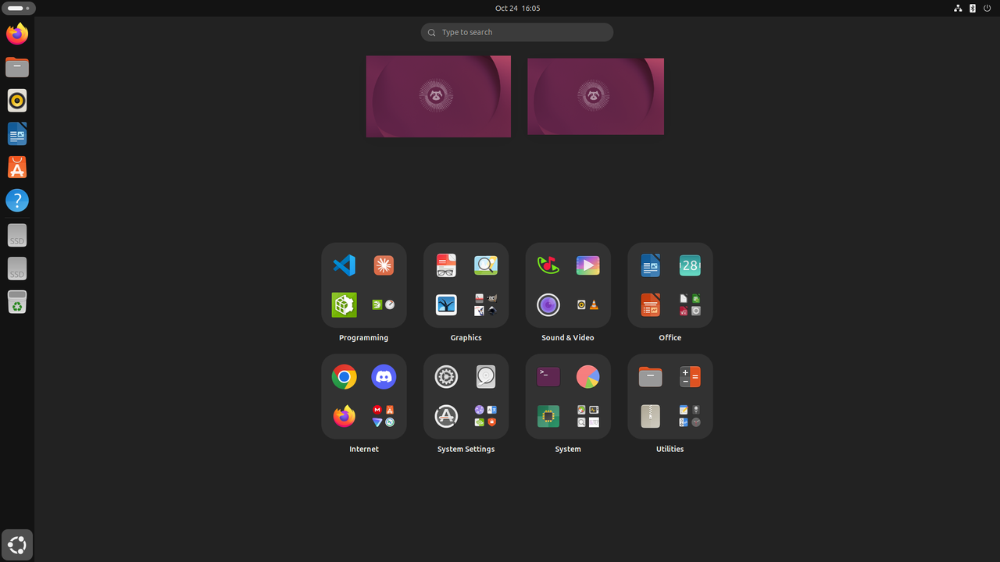
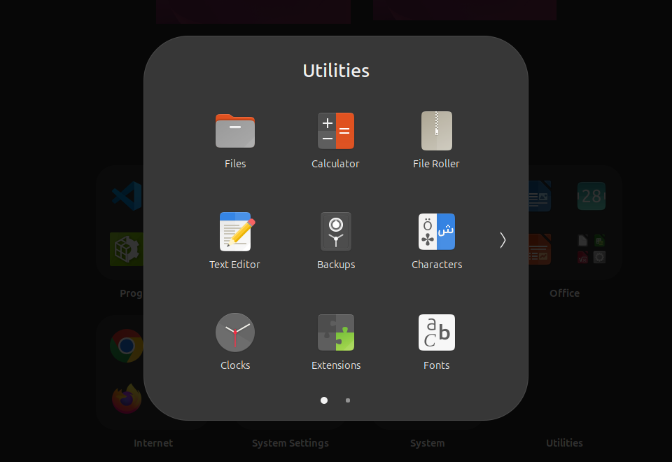

# Category Grid

Replaces the GNOME app grid with category tiles, like the Windows 11 start
menu. Each tile shows the three apps you use most in that category; click one
to launch it. The fourth cell opens the whole category.



Apps are sorted into categories automatically from their `.desktop` files, and
within a category by how often you use them. There is nothing to arrange by
hand, and nothing can be: apps can't be moved between categories, reordered or
renamed.



## Installation

Requires GNOME Shell 50. Used daily on Ubuntu 26.04; upstream GNOME on
Fedora 44 passes the automated tests.

Clone this repository, then install it from inside the clone:

```bash
gnome-extensions pack
gnome-extensions install --force *.shell-extension.zip
```

Log out and back in, and turn on Category Grid in the Extensions app.
Turning it off brings the original app grid back.

The extension builds on GNOME Shell internals, so a new GNOME release may
break it until it is updated. GNOME won't load it on a version it doesn't
list as supported, and if it fails to start, GNOME turns it off; either way
you get the original app grid.

## Development

`test/run.sh` runs the extension in a headless GNOME Shell, isolated from your
session. It opens the grid and a folder, drags apps to the dock, saves
screenshots to `test/shots/` and prints what it checked. `test/run-fedora.sh`
does the same on upstream GNOME in a Fedora container (podman or docker).
Both take a screen size and the variables listed at the top of `test/run.sh`:

```bash
MODE=ubuntu SCALE=1.5 test/run.sh 2560x1440
test/run-fedora.sh 1366x768
```

## License

[MIT-0](LICENSE): free for any use, no attribution required.
